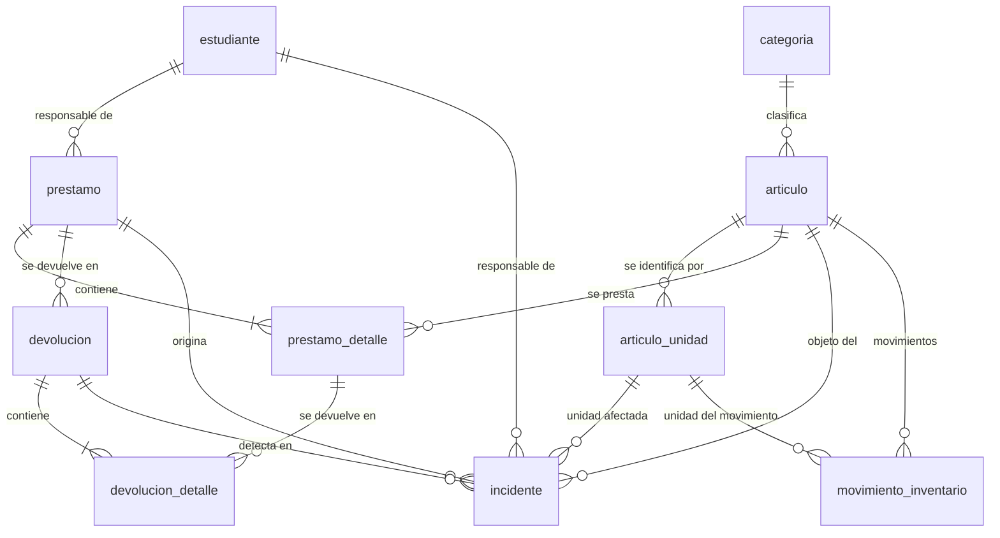

# StockLend — Diseño de la Base de Datos

> **Estado del documento:** diseño revisado (revisión 2). **No hay ninguna base de
> datos creada ni ejecutable.** El SQL de este documento es la especificación de la
> migración inicial (`stocklend/data/migrations/0001_inicial.sql`), que se escribirá
> en una etapa posterior. Versión de esquema propuesta: `user_version = 1`.

### Cambios de la revisión 2

| Cambio | Motivo |
|--------|--------|
| Nueva tabla `articulo_unidad` para códigos individuales opcionales | Los equipos pueden requerir identificación individual sin obligar a Sonia a identificar cada utensilio |
| `incidente` pasa a ser independiente: `prestamo_id` y `estudiante_id` admiten `NULL` | Un artículo puede perderse o dañarse sin que exista un préstamo |
| Nuevos tipos de movimiento con cubo de origen explícito | Evita que la misma unidad se descuente y sume en cubos incompatibles |
| `secuencia` se integra en `configuracion` | Una tabla menos sin pérdida de función |
| Se eliminan `correo`, `telefono`, `recibido_por` y `registrado_por` | Sistema de un solo usuario: campos de valor constante |
| `auditoria` y la tabla `respaldo` pasan a diferidas | No aportan al trabajo diario; se crean en su etapa |
| 18 índices reducidos a 13; 5 vistas reducidas a 2 | Tres índices eran redundantes con restricciones `UNIQUE` |

---

## 1. Convenciones

### 1.1 Tipos

| Concepto | Tipo SQLite | Motivo |
|----------|-------------|--------|
| Identificador | `INTEGER PRIMARY KEY AUTOINCREMENT` | Nunca se reutiliza un identificador |
| Fecha y hora | `TEXT` con ISO-8601 UTC (`2026-09-25T18:42:05Z`) | Ordena como texto, legible por cualquier herramienta, sin ambigüedad de zona |
| Fecha sin hora | `TEXT` con `YYYY-MM-DD` | Filtros de reporte |
| Cantidades | `INTEGER` | Las cantidades de utensilios son enteras |
| Booleano | `INTEGER` con `CHECK (valor IN (0,1))` | Booleano explícito y validado |
| Texto largo | `TEXT` | Sin truncamiento |
| Dinero | No se usa | El sistema no maneja costos |

**Nombres:** tablas en singular y en español. Columnas en `snake_case` y en español.
Claves foráneas `<tabla>_id`. Índices `ix_<tabla>_<columnas>`.

### 1.2 Sentencias prohibidas en la aplicación

| Prohibido | Motivo | Alternativa |
|-----------|--------|-------------|
| `DELETE FROM` sobre tablas de negocio | Rompe la trazabilidad (RN-46) | Marcar con `activo = 0`, `anulado` o `baja` |
| `UPDATE` sobre `movimiento_inventario` | Un movimiento es inmutable | Nuevo movimiento de ajuste |
| `UPDATE` sobre `devolucion` y `devolucion_detalle` | Una devolución es inmutable (RN-38) | Nueva devolución de corrección |
| Concatenar valores en el SQL | Inyección de SQL | Parámetros vinculados `?` |

Única excepción: al restaurar una copia se reemplaza el archivo completo,
no se borra contenido de negocio.

### 1.3 Integridad referencial

`PRAGMA foreign_keys = ON` en cada conexión. Todas las acciones `ON DELETE` son
`RESTRICT`: en esta base de datos **nada se borra**, y `RESTRICT` convierte
cualquier intento de borrado en un error explícito en lugar de un borrado
silencioso en cascada.

---

## 2. Diagrama de relaciones



`incidente` aparece con relaciones opcionales: puede existir sin `prestamo`,
sin `devolucion` y sin `estudiante` (sección 3.8).

### 2.1 Relaciones en texto

| Relación | Tipo | Regla |
|----------|------|-------|
| `categoria` → `articulo` | 1:N | Una categoría puede tener 0..N artículos |
| `articulo` → `articulo_unidad` | 1:N | Solo se usa si el artículo tiene control individual |
| `estudiante` → `prestamo` | 1:N | Un estudiante puede tener 0..N préstamos |
| `prestamo` → `prestamo_detalle` | 1:N | Un préstamo tiene 1..N renglones |
| `articulo` → `prestamo_detalle` | 1:N | Un artículo puede estar en muchos préstamos |
| `prestamo` → `devolucion` | 1:N | Un préstamo puede tener 1..N devoluciones parciales |
| `devolucion` → `devolucion_detalle` | 1:N | Toda devolución tiene 1..N renglones |
| `prestamo_detalle` → `devolucion_detalle` | 1:N | Un renglón puede tener varias devoluciones parciales |
| `incidente` → `prestamo` / `devolucion` / `estudiante` | N:1 opcional | Los tres pueden ser `NULL` |
| `articulo` → `movimiento_inventario` | 1:N | Libro de movimientos |

---

## 3. Inventario: dos dimensiones que no deben confundirse

Este es el punto central del diseño y la razón de la revisión 2.

El inventario de un artículo se describe con **cuatro cubos mutuamente excluyentes**
que suman el total de unidades bajo control:

```
cantidad_total = cantidad_disponible + cantidad_prestada + cantidad_daniada + cantidad_faltante
```

La lectura correcta de cada cubo:

| Cubo | Qué representa | Dimensión |
|------|----------------|-----------|
| `cantidad_disponible` | Unidades físicamente en la facultad, en condiciones de usarse | **Inventario físico** |
| `cantidad_prestada` | Unidades fuera de la facultad, en manos de un estudiante, **pendientes de devolución** | **Obligación pendiente** |
| `cantidad_daniada` | Unidades físicamente presentes pero inservibles | **Inventario físico** |
| `cantidad_faltante` | Unidades cuya pérdida se ha confirmado mediante un incidente | **Inventario físico** |

**`cantidad_prestada` es la única de las cuatro que es una obligación, no un hecho
físico.** Significa «estas unidades deben volver». Las otras tres describen dónde
está el artículo ahora mismo. Un artículo pendiente de devolución **no** aparece en
`cantidad_faltante` por el mero paso del tiempo (RN-39): solo cuando Sonia registra
un incidente de pérdida.

Por eso hay **dos vistas de lectura distintas y no intercambiables**:

| Vista | Pregunta que responde | Origen del dato |
|-------|----------------------|-----------------|
| Inventario físico | ¿Cuántas unidades hay y en qué estado? | `articulo.cantidad_*` |
| Obligaciones pendientes | ¿Qué debe volver y de quién? | `prestamo_detalle` vía `v_prestamo_detalle.cantidad_pendiente` |

La igualdad entre ambas es una **coincidencia de una operación concreta**
(que es exactamente lo que devuelve un artículo en buenas condiciones), no una
equivalencia permanente. Un artículo devuelto dañado sale de `cantidad_prestada` y
entra en `cantidad_daniada`: la obligación se extingue pero la unidad sigue en el
inventario físico, inservible. Esa es precisamente la razón de existir del cubo
`danada`: impide que una unidad dañada vuelva a contarse como disponible.

### 3.1 La operación donde es fácil duplicar cantidades

Devolver **dañado** es el caso crítico. La unidad sale de `prestada` y entra en
`danada`. Un error de implementación suma a los dos cubos:

| | `total` | `disponible` | `prestada` | `danada` | Suma de cubos | ¿Correcto? |
|---|---------|--------------|------------|----------|---------------|-----------|
| **Antes** (4 disponibles + 2 prestadas) | 6 | 4 | 2 | 0 | 6 | Sí |
| **Implementación correcta:** `prestada -= 1`, `danada += 1` | 6 | 4 | 1 | 1 | 6 | **Sí** |
| **Implementación con error:** `prestada -= 1`, `danada += 1`, `disponible += 1` | 6 | 5 | 1 | 1 | 7 | **No** |

En la versión con error, la suma de los cubos (7) deja de coincidir con el total
(6). **La invariante RN-02 detecta el fallo de inmediato**, y la prueba de
reconciliación contra `movimiento_inventario` lo detecta aunque alguien lo
introdujera saltándose el servicio.

El error inverso también está cubierto: una unidad perdida **nunca** reduce
`cantidad_total` (RN-60). Sigue bajo control de la facultad y consta como faltante.
Solo una baja física (`baja_daniada` o `baja_faltante`) reduce el total.

### 3.2 Cómo se actualiza cada cantidad, operación por operación

Regla general: **cada unidad se resta de exactamente un cubo y se suma a
exactamente un cubo** (RN-58). El cubo de origen se indica en el propio tipo de
movimiento, de modo que el efecto es determinista y la reconciliación es una
igualdad exacta.

| Operación | `total` | `disponible` | `prestada` | `danada` | `faltante` | Movimiento |
|-----------|---------|--------------|------------|----------|-------------|-----------|
| Alta de artículo con cantidad *n* | +n | +n | — | — | — | `alta` |
| Ingreso posterior de unidades | +n | +n | — | — | — | `ajuste_positivo` |
| Ajuste a la baja desde disponible | −n | −n | — | — | — | `ajuste_negativo` |
| Préstamo de *n* unidades | — | −n | +n | — | — | `prestamo` |
| Devolución en buen estado | — | +n | −n | — | — | `devolucion` |
| Devolución dañada (venía de `prestada`) | — | — | −n | +n | — | `danio_prestado` |
| Pérdida con préstamo (venía de `prestada`) | — | — | −n | — | +n | `perdida_prestado` |
| Daño en stock, sin préstamo | — | −n | — | +n | — | `danio_disponible` |
| Pérdida en stock, sin préstamo | — | −n | — | — | +n | `perdida_disponible` |
| Reparación: reingresa una unidad dañada | — | +n | — | −n | — | `reingreso_reparacion` |
| Baja física de una unidad dañada | −n | — | — | −n | — | `baja_daniada` |
| Baja física de una unidad faltante | −n | — | — | — | −n | `baja_faltante` |
| Anulación de préstamo | — | +n | −n | — | — | `devolucion` con `referencia_tipo = 'anulacion'` |
| Conteo físico: sobrante | +n | +n | — | — | — | `ajuste_positivo` con motivo «Conteo físico…» |
| Conteo físico: faltante en depósito | −n | −n | — | — | — | `ajuste_negativo` con motivo «Conteo físico…» |

Lectura de la tabla: las columnas vacías significan «esa cantidad no se toca».
Ninguna fila suma la misma unidad a dos cubos, y ninguna fila cambia `total` sin
que la unidad desaparezca físicamente de la facultad.

---

## 4. Entidades

### 4.1 `categoria`

| Columna | Tipo | Restricciones | Descripción |
|---------|------|---------------|-------------|
| `id` | INTEGER | PK, AUTOINCREMENT | Identificador |
| `nombre` | TEXT | NOT NULL COLLATE NOCASE UNIQUE | Nombre de la categoría |
| `descripcion` | TEXT | NULL | Nota opcional |
| `activo` | INTEGER | NOT NULL, DEFAULT 1, CHECK (0,1) | Permite desactivar sin borrar |
| `creado_en` | TEXT | NOT NULL | Fecha de alta |

`COLLATE NOCASE` hace que el `UNIQUE` ignore mayúsculas y espacios finales, lo que
implementa RN-10.

---

### 4.2 `articulo`

| Columna | Tipo | Restricciones | Descripción |
|---------|------|---------------|-------------|
| `id` | INTEGER | PK, AUTOINCREMENT | Identificador |
| `codigo` | TEXT | COLLATE NOCASE UNIQUE | Código interno opcional |
| `nombre` | TEXT | NOT NULL COLLATE NOCASE | Nombre del artículo |
| `categoria_id` | INTEGER | NOT NULL, FK → `categoria(id)` | Categoría |
| `unidad_medida` | TEXT | NOT NULL, DEFAULT 'unidad' | Pieza, juego, litro, kg… |
| `notas` | TEXT | NULL | Observaciones |
| `control_individual` | INTEGER | NOT NULL, DEFAULT 0, CHECK (0,1) | ¿Se identifica unidad por unidad? |
| `prestable` | INTEGER | NOT NULL, DEFAULT 1, CHECK (0,1) | Admite préstamos (RF-INV-09) |
| `activo` | INTEGER | NOT NULL, DEFAULT 1, CHECK (0,1) | Permite archivar sin borrar |
| **`cantidad_total`** | INTEGER | NOT NULL, DEFAULT 0, CHECK (>= 0) | Unidades bajo control |
| **`cantidad_disponible`** | INTEGER | NOT NULL, DEFAULT 0, CHECK (>= 0) | Inventario físico: usables |
| **`cantidad_prestada`** | INTEGER | NOT NULL, DEFAULT 0, CHECK (>= 0) | Obligación: pendientes de devolución |
| **`cantidad_daniada`** | INTEGER | NOT NULL, DEFAULT 0, CHECK (>= 0) | Inventario físico: inservibles |
| **`cantidad_faltante`** | INTEGER | NOT NULL, DEFAULT 0, CHECK (>= 0) | Inventario físico: pérdida confirmada |
| `creado_en` | TEXT | NOT NULL | Fecha de alta |
| `actualizado_en` | TEXT | NOT NULL | Última modificación |

Las cinco columnas en negrita son el estado del inventario. Se actualizan siempre
dentro de la misma transacción que inserta el movimiento correspondiente.

**Invariante (RN-02), verificada en tres niveles:**

1. El servicio la respeta en cada operación.
2. Todos los `CHECK` individuales impiden valores negativos en cualquier caso.
3. `tests/integration/test_reconciliacion.py` recalcula cada cubo desde
   `movimiento_inventario` y compara. Se ejecuta tras cada prueba de inventario,
   préstamo o devolución. Si la consulta de la sección 8.6 devuelve una sola fila,
   hay un error y hay que corregirlo antes de seguir.

**Sobre `control_individual` (revisión 2).** El valor por defecto es `0`, de modo
que Sonia **no** tiene que identificar nada: «Olla: 10 unidades» sigue siendo un
único registro. Solo cuando se marca `1` se usan las filas de `articulo_unidad`.
El modelo admite ambos casos en la misma base sin que uno condicione al otro.

---

### 4.3 `articulo_unidad` — identificación individual opcional

Existe únicamente para los artículos con `control_individual = 1`. Para un artículo
sin control individual, esta tabla está vacía y no añade ningún dato ni complica
el uso diario.

| Columna | Tipo | Restricciones | Descripción |
|---------|------|---------------|-------------|
| `id` | INTEGER | PK, AUTOINCREMENT | Identificador |
| `articulo_id` | INTEGER | NOT NULL, FK → `articulo(id)` | Artículo al que pertenece |
| `codigo` | TEXT | NOT NULL COLLATE NOCASE UNIQUE | Código individual (número de serie, inventario) |
| `descripcion` | TEXT | NULL | Descripción de la unidad |
| `estado` | TEXT | NOT NULL, CHECK IN ('disponible','prestada','danada','faltante','baja') | Estado de la unidad |
| `prestamo_detalle_id` | INTEGER | NULL, FK → `prestamo_detalle(id)` | Renglón que la lleva; obligatorio si `estado = 'prestada'` (RN-53) |
| `verificado_en` | TEXT | NULL | Última verificación física |
| `notas` | TEXT | NULL | Observaciones |
| `creado_en` | TEXT | NOT NULL | Fecha de alta |
| `actualizado_en` | TEXT | NOT NULL | Última modificación |

**Invariante puente (RN-61).** Para todo artículo con `control_individual = 1`:

```
articulo.cantidad_total       = COUNT(unidades con estado <> 'baja')
articulo.cantidad_disponible  = COUNT(unidades con estado = 'disponible')
articulo.cantidad_prestada    = COUNT(unidades con estado = 'prestada')
articulo.cantidad_daniada     = COUNT(unidades con estado = 'danada')
articulo.cantidad_faltante    = COUNT(unidades con estado = 'faltante')
```

La consulta que lo verifica está en la sección 8.7. Esto es lo que impide que el
detalle individual y los contadores agregado diverjan.

**Motivos de los estados de unidad:**

| `estado` | Significado |
|----------|-------------|
| `disponible` | En la facultad, en condiciones de usarse |
| `prestada` | Fuera con un estudiante; `prestamo_detalle_id` es obligatorio (CHECK) |
| `danada` | Presente pero inservible |
| `faltante` | Pérdida confirmada por incidente |
| `baja` | Descarteada físicamente; excluida del total |

`baja` es un estado, no un borrado: la fila se conserva y el histórico de la unidad
permanece consultable.

---

### 4.4 `estudiante`

| Columna | Tipo | Restricciones | Descripción |
|---------|------|---------------|-------------|
| `id` | INTEGER | PK, AUTOINCREMENT | Identificador interno |
| `codigo_universitario` | TEXT | NOT NULL COLLATE NOCASE UNIQUE | Clave natural (RN-11) |
| `nombres` | TEXT | NOT NULL | Nombres |
| `apellidos` | TEXT | NOT NULL | Apellidos |
| `activo` | INTEGER | NOT NULL, DEFAULT 1, CHECK (0,1) | Inactivo en vez de borrado (RN-14) |
| `creado_en` | TEXT | NOT NULL | Fecha de alta |
| `actualizado_en` | TEXT | NOT NULL | Última modificación |

El `id` es interno porque el código universitario es la clave natural y puede
contener guiones, letras y ceros a la izquierda. La interfaz muestra y recibe el
código, nunca el `id`.

**Eliminados en la revisión 2:** `correo` y `telefono`. Ningún requisito
confirmado los usa, la aplicación no envía correo y el sistema no tiene red. Se
reincorporan solo si aparece un requisito que los necesite.

---

### 4.5 `prestamo`

| Columna | Tipo | Restricciones | Descripción |
|---------|------|---------------|-------------|
| `id` | INTEGER | PK, AUTOINCREMENT | Identificador interno |
| `folio` | TEXT | NOT NULL UNIQUE | `PRE-2026-000001` (RN-20) |
| `estudiante_id` | INTEGER | NOT NULL, FK → `estudiante(id)` | Responsable (RF-PRE-01) |
| `fecha_prestamo` | TEXT | NOT NULL | Fecha y hora de entrega (RF-PRE-02) |
| `fecha_limite` | TEXT | NULL | **Opcional.** Si es `NULL`, no hay vencimiento (RN-25) |
| `estado` | TEXT | NOT NULL, CHECK IN ('activo','cerrado','anulado') | Estado |
| `comentario` | TEXT | NULL | Contexto: práctica, grupo (RF-PRE-09) |
| `creado_en` | TEXT | NOT NULL | Registro |
| `cerrado_en` | TEXT | NULL | Momento del cierre |

**Sobre `fecha_limite` (ADR-04):** se crea con valor `NULL`. El sistema **no** marca
ningún préstamo como vencido mientras `fecha_limite` sea `NULL`. El cálculo de
vencido solo existe si Sonia decide usarlo, y se implementaría como
`fecha_limite IS NOT NULL AND fecha_limite < :ahora`. No se inventa una política de
plazos que el proceso real no tiene. Sin ese campo, la alerta de la sección de
préstamos pendientes **solo** muestra que hay unidades sin devolver, nunca un
supuesto «día de atraso».

**Folio:** se genera en el servicio a partir de la clave
`folio_prestamo_<año>` en la tabla `configuracion`, dentro de la misma transacción
del alta. El patrón `PRE-<año>-<6 dígitos>` ordena por año y es fácil de dictar.

---

### 4.6 `prestamo_detalle`

Un renglón del préstamo: un artículo y la cantidad entregada.

| Columna | Tipo | Restricciones | Descripción |
|---------|------|---------------|-------------|
| `id` | INTEGER | PK, AUTOINCREMENT | Identificador |
| `prestamo_id` | INTEGER | NOT NULL, FK → `prestamo(id)` | Préstamo |
| `articulo_id` | INTEGER | NOT NULL, FK → `articulo(id)` | Artículo |
| `cantidad_prestada` | INTEGER | NOT NULL, CHECK (> 0) | Unidades entregadas |
| `cantidad_devuelta` | INTEGER | NOT NULL, DEFAULT 0, CHECK (>= 0) | Devueltas en buen estado |
| `cantidad_daniada` | INTEGER | NOT NULL, DEFAULT 0, CHECK (>= 0) | Devueltas dañadas |
| `cantidad_perdida` | INTEGER | NOT NULL, DEFAULT 0, CHECK (>= 0) | Declaradas perdidas |
| `estado` | TEXT | NOT NULL, CHECK IN ('pendiente','parcial','devuelto','con_incidente') | Derivado de las cantidades |
| `notas` | TEXT | NULL | Observación del renglón |

`UNIQUE (prestamo_id, articulo_id)`: un artículo no se repite dentro del mismo
préstamo; el servicio suma las cantidades si se repite (RN-18).

**Cantidad pendiente (RN-04):** es una **obligación**, no un cubo de inventario.
No se almacena en `articulo` y no tiene columna propia:

```
cantidad_pendiente = cantidad_prestada - cantidad_devuelta - cantidad_daniada - cantidad_perdida
```

Se expone como columna de la vista `v_prestamo_detalle` (sección 6) para que los
listados y el panel no dependan del cálculo en Python.

Los artículos pendientes **permanecen asociados a su préstamo** mientras no se
resuelven: no se mueven de renglón, no se archivan y no se reasignan. Un artículo
pendiente solo deja de estarlo por una devolución, por un daño o por una pérdida,
cada una con su registro.

---

### 4.7 `devolucion` y `devolucion_detalle`

**`devolucion`** — encabezado. Un préstamo puede tener varias (RN-36).

| Columna | Tipo | Restricciones | Descripción |
|---------|------|---------------|-------------|
| `id` | INTEGER | PK, AUTOINCREMENT | Identificador |
| `prestamo_id` | INTEGER | NOT NULL, FK → `prestamo(id)` | Préstamo devuelto |
| `fecha_devolucion` | TEXT | NOT NULL | Fecha y hora (RN-37) |
| `observaciones` | TEXT | NULL | Comentario general |
| `creado_en` | TEXT | NOT NULL | Registro |

**`devolucion_detalle`** — un renglón de la devolución.

| Columna | Tipo | Restricciones | Descripción |
|---------|------|---------------|-------------|
| `id` | INTEGER | PK, AUTOINCREMENT | Identificador |
| `devolucion_id` | INTEGER | NOT NULL, FK → `devolucion(id)` | Devolución |
| `prestamo_detalle_id` | INTEGER | NOT NULL, FK → `prestamo_detalle(id)` | Renglón del préstamo |
| `cantidad_devuelta` | INTEGER | NOT NULL, DEFAULT 0, CHECK (>= 0) | En buen estado (RN-30) |
| `cantidad_daniada` | INTEGER | NOT NULL, DEFAULT 0, CHECK (>= 0) | Dañadas (RN-31) |
| `cantidad_perdida` | INTEGER | NOT NULL, DEFAULT 0, CHECK (>= 0) | Perdidas (RN-32) |
| `notas` | TEXT | NULL | Observación del renglón |

`devolucion` es **inmutable** (RN-38). No tiene `actualizado_en` a propósito: si
algo se registró mal, la corrección es una devolución nueva.

**Restricción de coherencia (RN-27):** en cada renglón,
`devuelta + dañada + perdida ≤ pendiente`. Se valida en el servicio contra
`v_prestamo_detalle.cantidad_pendiente` **dentro de la misma transacción**, con
`BEGIN IMMEDIATE`, para que dos devoluciones simultáneas no puedan superar el
pendiente.

`UNIQUE (devolucion_id, prestamo_detalle_id)`: un renglón no se repite dentro de
una misma devolución.

**Eliminado en la revisión 2:** `recibido_por`. En un sistema de un solo usuario es
un valor constante.

---

### 4.8 `incidente` — independiente de préstamos y estudiantes

Un artículo puede perderse o dañarse sin que exista un préstamo: una licuadora que
se rompe en el depósito, un cuchillo que no aparece en el conteo. El incidente
registra el hecho; **la responsabilidad solo se atribuye cuando el registro la
evidencia** (RN-55).

| Columna | Tipo | Restricciones | Descripción |
|---------|------|---------------|-------------|
| `id` | INTEGER | PK, AUTOINCREMENT | Identificador |
| `tipo` | TEXT | NOT NULL, CHECK IN ('perdida','danio','otro') | Tipo (RN-41) |
| `estado` | TEXT | NOT NULL, DEFAULT 'abierto', CHECK IN ('abierto','resuelto') | Estado (RN-42) |
| **`origen`** | TEXT | NOT NULL, CHECK IN ('stock','prestamo','devolucion') | Dónde se detectó |
| `prestamo_id` | INTEGER | **NULL**, FK → `prestamo(id)` | Préstamo, si existe |
| `prestamo_detalle_id` | INTEGER | NULL, FK → `prestamo_detalle(id)` | Renglón exacto, si aplica |
| `devolucion_id` | INTEGER | **NULL**, FK → `devolucion(id)` | Devolución que lo originó |
| `articulo_id` | INTEGER | NOT NULL, FK → `articulo(id)` | Artículo afectado |
| `articulo_unidad_id` | INTEGER | NULL, FK → `articulo_unidad(id)` | Unidad, si hay control individual |
| `estudiante_id` | INTEGER | **NULL**, FK → `estudiante(id)` | Responsable, solo si el registro lo evidencia |
| **`responsabilidad`** | TEXT | NOT NULL, DEFAULT 'sin_determinar', CHECK IN ('estudiante','facultad','sin_determinar') | Quién responde |
| `cantidad` | INTEGER | NOT NULL, CHECK (> 0) | Unidades afectadas |
| `descripcion` | TEXT | NOT NULL, CHECK (length(trim(descripcion)) > 0) | Qué ocurrió (RN-33) |
| `resolucion` | TEXT | NULL | Texto de resolución (RN-43) |
| `resuelto_en` | TEXT | NULL | Fecha de resolución |
| `creado_en` | TEXT | NOT NULL | Registro |

### 4.8.1 Las tres relaciones opcionales

| `origen` | Significado | `prestamo_id` | `devolucion_id` | `estudiante_id` |
|----------|-------------|---------------|-----------------|-----------------|
| `stock` | Daño o pérdida en la facultad, sin entrega a terceros | `NULL` | `NULL` | `NULL` salvo que conste en el registro |
| `prestamo` | Detectado con un préstamo vigente, sin devolución | obligatorio | `NULL` | el del préstamo |
| `devolucion` | Detectado al recibir la devolución | obligatorio | obligatorio | el del préstamo |

`origen` determina también el **tipo de movimiento** que se registra:

| `origen` | Tipo `perdida` | Tipo `danio` |
|----------|----------------|--------------|
| `stock` | `perdida_disponible` | `danio_disponible` |
| `prestamo` | `perdida_prestado` | `danio_prestado` |
| `devolucion` | `perdida_prestado` | `danio_prestado` |

Esta correspondencia es la que impide el error del punto 3.1: una unidad que sale
de `prestada` nunca descuenta de `disponible`, y viceversa.

### 4.8.2 Restricciones que protegen la responsabilidad

Cuatro `CHECK` hacen imposible la atribución indebida a nivel de base de datos,
sin depender de que la interfaz se comporte bien:

```sql
CHECK (origen = 'stock'       OR prestamo_id   IS NOT NULL),
CHECK (origen <> 'devolucion' OR devolucion_id IS NOT NULL),
CHECK (devolucion_id IS NULL  OR origen = 'devolucion'),
CHECK (responsabilidad <> 'estudiante' OR estudiante_id IS NOT NULL)
```

Una quinta garantía —el incidente siempre tiene artículo— la impone la propia
columna con `NOT NULL`, no un `CHECK` aparte.

Los tres primeros `CHECK` sobre el origen dicen exactamente dos cosas, y solo
dos cosas pueden ser verdad a la vez:

| Relación | Solo puede existir cuando |
|----------|---------------------------|
| `prestamo_id` | `origen` es `prestamo` o `devolucion` |
| `devolucion_id` | `origen` es exactamente `devolucion` |

Efecto práctico:

- Un incidente de `origen = 'stock'` **no puede** tener `devolucion_id`, así que no
  se puede inventar una entrega para justificar un cargo.
- Un incidente con `responsabilidad = 'estudiante'` **exige** `estudiante_id`.
- El valor por defecto es `sin_determinar`, de modo que el sistema **nunca** imputa
  una pérdida a un estudiante por omisión. Para pasar a `estudiante` hay que elegir
  explícitamente un estudiante en el formulario, y esa elección queda registrada
  como un incidente más, con su fecha y su descripción.

Cuando el estudiante aparece, la relación con el préstamo se conserva íntegra
(RN-57): no se copia su nombre al incidente ni se pierde el vínculo.

---

### 4.9 `movimiento_inventario`

El libro de movimientos. **Tabla de solo adición** (RN-46, RN-47). Es lo que permite
reconstruir cualquier cantidad y detectar cualquier error de contadores.

| Columna | Tipo | Restricciones | Descripción |
|---------|------|---------------|-------------|
| `id` | INTEGER | PK, AUTOINCREMENT | Identificador |
| `articulo_id` | INTEGER | NOT NULL, FK → `articulo(id)` | Artículo |
| `articulo_unidad_id` | INTEGER | NULL, FK → `articulo_unidad(id)` | Unidad, si hay control individual |
| `tipo` | TEXT | NOT NULL, CHECK IN (12 valores) | Tipo de movimiento (4.9.1) |
| `cantidad` | INTEGER | NOT NULL, CHECK (> 0) | Siempre positiva |
| `cantidad_resultante_total` | INTEGER | NOT NULL, CHECK (>= 0) | Total tras el movimiento |
| `cantidad_resultante_disponible` | INTEGER | NOT NULL, CHECK (>= 0) | Disponible tras el movimiento |
| `motivo` | TEXT | NOT NULL, CHECK (length(trim(motivo)) > 0) | Motivo no vacío (RN-05) |
| `referencia_tipo` | TEXT | NULL, CHECK IN ('prestamo','devolucion','incidente','ajuste','anulacion') | Origen |
| `referencia_id` | INTEGER | NULL | Identificador de la tabla de origen |
| `fecha` | TEXT | NOT NULL | Fecha y hora |

`cantidad` es **siempre positiva**; la dirección del efecto la define `tipo` junto
con el cubo de origen. Esto elimina el error de tener un movimiento con signo
ambiguo y hace la reconciliación una igualdad exacta.

**Qué resultantes se guardan.** Se almacenan solo `cantidad_resultante_total` y
`cantidad_resultante_disponible`: los dos valores que se consultan en pantalla y en
el panel. `prestada`, `danada` y `faltante` **no** se duplican en cada fila; se
reconstruyen desde el libro con las fórmulas de la sección 8.6. Así el libro no
contiene dos fuentes de verdad que puedan divergir entre sí.

**`articulo_unidad_id`** permite que el rastro llegue hasta la unidad concreta
cuando el artículo tiene control individual. Para el resto de artículos es `NULL`
y no añade complejidad.

**Eliminado en la revisión 2:** `registrado_por`, valor constante en un sistema de
un solo usuario.

### 4.9.1 Los 12 tipos de movimiento

Cada tipo declara el cubo de **origen** y el cubo de **destino**. Ninguno permite
que una unidad se descuente y sume en cubos incompatibles.

| `tipo` | Efecto sobre `articulo` | Cuándo se usa |
|--------|--------------------------|---------------|
| `alta` | `total += n`, `disponible += n` | Alta del artículo |
| `ajuste_positivo` | `total += n`, `disponible += n` | Ingreso posterior, sobrante de conteo |
| `ajuste_negativo` | `total -= n`, `disponible -= n` | Ajuste a la baja, faltante en depósito (RN-06) |
| `prestamo` | `disponible -= n`, `prestada += n` | Entrega al estudiante |
| `devolucion` | `prestada -= n`, `disponible += n` | Retour en buen estado; también anulación, con `referencia_tipo = 'anulacion'` |
| **`danio_prestado`** | `prestada -= n`, `danada += n` | Daño en una unidad que estaba fuera, con préstamo |
| **`perdida_prestado`** | `prestada -= n`, `faltante += n` | Pérdida de una unidad que estaba fuera, con préstamo |
| **`danio_disponible`** | `disponible -= n`, `danada += n` | Daño en la facultad, sin préstamo |
| **`perdida_disponible`** | `disponible -= n`, `faltante += n` | Pérdida en la facultad, sin préstamo |
| `reingreso_reparacion` | `danada -= n`, `disponible += n` | Unidad reparada y devuelta al uso (RN-34) |
| `baja_daniada` | `danada -= n`, `total -= n` | Descarte físico de una unidad inservible |
| `baja_faltante` | `faltante -= n`, `total -= n` | Descarte físico de una unidad cuya pérdida ya se había confirmado |

**Por qué cuatro tipos en lugar de dos** (`danio` y `perdida`): el efecto sobre los
contadores depende de dónde estaba la unidad. Un `danio` sobre una unidad que
venía de `prestada` debe restar de `prestada`; un `danio` sobre una unidad en
depósito debe restar de `disponible`. Con un solo tipo, el servicio tendría que
decidir el cubo de origen en tiempo de ejecución y la reconciliación dejaría de
ser una igualdad exacta. Con el cubo declarado en el tipo, el efecto es
determinista y verificable (RN-59).

---

### 4.10 `configuracion`

Sustituye a la antigua tabla `secuencia` (revisión 2).

| Columna | Tipo | Restricciones |
|---------|------|---------------|
| `clave` | TEXT | PK |
| `valor` | TEXT | NOT NULL |
| `actualizado_en` | TEXT | NOT NULL |

Claves previstas: `folio_prestamo_<año>` (contador de folios), `copias_conservadas`,
`ultimo_respaldo`, `ultima_verificacion`.

El contador de folios se incrementa con `UPDATE configuracion SET valor = valor + 1`
dentro de la transacción del alta, lo que garantiza folios consecutivos y sin huecos
por fallo a mitad.

---

## 5. Componentes: indispensables y diferidos

### 5.1 Indispensables en la primera versión

| Componente | Por qué es imprescindible |
|------------|---------------------------|
| `categoria` | Requisito confirmado RF-INV-02 |
| `articulo` con los 5 contadores | Núcleo del sistema (RF-INV-01, 03, 05, 07) |
| `articulo_unidad` | Requisito del prompt 02, punto 1. Solo se usa con `control_individual = 1` |
| `estudiante` | RF-EST-01 a RF-EST-06 |
| `prestamo` + `prestamo_detalle` | RF-PRE-01 a RF-PRE-09 |
| `devolucion` + `devolucion_detalle` | RF-DEV-01 a RF-DEV-08, con devoluciones parciales |
| `incidente` independiente | Requisito del prompt 02, punto 2; RF-DEV-05, RF-ALA-02 |
| `movimiento_inventario` | Trazabilidad de todo el inventario (RN-05, RN-46, RN-49) |
| `configuracion` | Folios y preferencias; sustituye a `secuencia` |
| Vistas `v_prestamo_detalle` y `v_prestamo_resumen` | `cantidad_pendiente` y totales por préstamo en SQL, sin lógica duplicada en Python |
| 13 índices | Ver sección 7 |

### 5.2 Diferidos a etapas posteriores

No se crean en la versión 1. Se documentan aquí para que quede constancia de que
fueron considerados y descartados deliberadamente, no olvidados.

| Componente | Motivo del aplazamiento | Etapa |
|------------|------------------------|-------|
| Tabla `auditoria` | El movimiento ya da trazabilidad del inventario. Los cambios en datos maestros son raros y RN-15 ya garantiza que no alteran el historial | 2 |
| Tabla `respaldo` | Solo hace falta cuando exista la pantalla de respaldos, en la etapa 8 | 8 |
| Vistas `v_inventario`, `v_alertas_prestamos`, `v_alertas_incidentes` | Una consulta en el repositorio es igual de clara que una vista, y evita duplicar el esquema | 7 |
| Índices `ix_articulo_activo`, `ix_estudiante_codigo`, `ix_prestamo_detalle_prestamo`, `ix_devolucion_detalle_devolucion` | Los tres últimos ya están cubiertos por índices `UNIQUE`; el primero por `ix_articulo_nombre` | — |
| `ix_movimiento_referencia` | Navegar desde un movimiento hasta su origen es útil, pero con este volumen el filtrado por fecha o por artículo basta | 7 |
| FTS5 para búsqueda | A 200–500 artículos un `LIKE` es instantáneo | Solo si supera 2 000 |
| Generación de PDF | El prompt pide preparar la arquitectura, no implementar la exportación | 7 |
| `transferencia_entrada` / `transferencia_salida` | No hay más de una sede | Si aparece una segunda ubicación |
| Subcategorías | No está en ningún requisito confirmado | Si la facultad las pide |
| Campos de contacto del estudiante | Sin uso confirmado y sin red | Si aparece un requisito |
| Multiusuario y autenticación | Fuera de alcance declarado | No previsto |

**Requisito funcional que se conserva intacto:** nada de la sección 5.2 elimina un
requisito de `REQUIREMENTS.md`. Lo único que se reduce es la forma de decirlo: el
comportamiento pedido sigue existiendo, solo cambia dónde se implementa.

---

## 6. Definición de datos (especificación de la migración inicial)

SQL de referencia. **No se ha ejecutado ni aplicado.**

```sql
-- ============================================================================
-- StockLend — migración inicial.  user_version = 1   (revisión 2)
-- ============================================================================

PRAGMA foreign_keys = ON;

-- ---------------------------------------------------------------- categoria
CREATE TABLE categoria (
    id          INTEGER PRIMARY KEY AUTOINCREMENT,
    nombre      TEXT    NOT NULL COLLATE NOCASE UNIQUE,
    descripcion TEXT,
    activo      INTEGER NOT NULL DEFAULT 1 CHECK (activo IN (0, 1)),
    creado_en   TEXT    NOT NULL
);

-- ----------------------------------------------------------------- articulo
CREATE TABLE articulo (
    id                  INTEGER PRIMARY KEY AUTOINCREMENT,
    codigo              TEXT    COLLATE NOCASE UNIQUE,
    nombre              TEXT    NOT NULL COLLATE NOCASE,
    categoria_id        INTEGER NOT NULL
                        REFERENCES categoria(id) ON DELETE RESTRICT,
    unidad_medida       TEXT    NOT NULL DEFAULT 'unidad',
    notas               TEXT,
    control_individual  INTEGER NOT NULL DEFAULT 0 CHECK (control_individual IN (0, 1)),
    prestable           INTEGER NOT NULL DEFAULT 1 CHECK (prestable IN (0, 1)),
    activo              INTEGER NOT NULL DEFAULT 1 CHECK (activo IN (0, 1)),

    cantidad_total       INTEGER NOT NULL DEFAULT 0 CHECK (cantidad_total      >= 0),
    cantidad_disponible  INTEGER NOT NULL DEFAULT 0 CHECK (cantidad_disponible >= 0),
    cantidad_prestada    INTEGER NOT NULL DEFAULT 0 CHECK (cantidad_prestada   >= 0),
    cantidad_daniada     INTEGER NOT NULL DEFAULT 0 CHECK (cantidad_daniada    >= 0),
    cantidad_faltante    INTEGER NOT NULL DEFAULT 0 CHECK (cantidad_faltante   >= 0),

    creado_en           TEXT    NOT NULL,
    actualizado_en      TEXT    NOT NULL
);

-- -------------------------------------------------------------- estudiante
CREATE TABLE estudiante (
    id                   INTEGER PRIMARY KEY AUTOINCREMENT,
    codigo_universitario TEXT    NOT NULL COLLATE NOCASE UNIQUE,
    nombres              TEXT    NOT NULL,
    apellidos            TEXT    NOT NULL,
    activo               INTEGER NOT NULL DEFAULT 1 CHECK (activo IN (0, 1)),
    creado_en            TEXT    NOT NULL,
    actualizado_en       TEXT    NOT NULL
);

-- ---------------------------------------------------------------- prestamo
CREATE TABLE prestamo (
    id             INTEGER PRIMARY KEY AUTOINCREMENT,
    folio          TEXT    NOT NULL UNIQUE,
    estudiante_id  INTEGER NOT NULL REFERENCES estudiante(id) ON DELETE RESTRICT,
    fecha_prestamo TEXT    NOT NULL,
    fecha_limite   TEXT,
    estado         TEXT    NOT NULL
                   CHECK (estado IN ('activo', 'cerrado', 'anulado')),
    comentario     TEXT,
    creado_en      TEXT    NOT NULL,
    cerrado_en     TEXT
);

-- -------------------------------------------------------- prestamo_detalle
CREATE TABLE prestamo_detalle (
    id                  INTEGER PRIMARY KEY AUTOINCREMENT,
    prestamo_id         INTEGER NOT NULL REFERENCES prestamo(id) ON DELETE RESTRICT,
    articulo_id         INTEGER NOT NULL REFERENCES articulo(id) ON DELETE RESTRICT,
    cantidad_prestada   INTEGER NOT NULL CHECK (cantidad_prestada > 0),
    cantidad_devuelta   INTEGER NOT NULL DEFAULT 0 CHECK (cantidad_devuelta >= 0),
    cantidad_daniada    INTEGER NOT NULL DEFAULT 0 CHECK (cantidad_daniada  >= 0),
    cantidad_perdida    INTEGER NOT NULL DEFAULT 0 CHECK (cantidad_perdida  >= 0),
    estado              TEXT    NOT NULL
                        CHECK (estado IN ('pendiente', 'parcial', 'devuelto', 'con_incidente')),
    notas               TEXT,
    UNIQUE (prestamo_id, articulo_id)
);

-- -------------------------------------------------------- articulo_unidad
-- Se crea DESPUÉS de prestamo_detalle porque lo referencia (FK).
-- Solo tiene filas para artículos con articulo.control_individual = 1.
CREATE TABLE articulo_unidad (
    id                  INTEGER PRIMARY KEY AUTOINCREMENT,
    articulo_id         INTEGER NOT NULL REFERENCES articulo(id) ON DELETE RESTRICT,
    codigo              TEXT    NOT NULL COLLATE NOCASE UNIQUE,
    descripcion         TEXT,
    estado              TEXT    NOT NULL
                        CHECK (estado IN ('disponible','prestada','danada','faltante','baja')),
    prestamo_detalle_id INTEGER REFERENCES prestamo_detalle(id) ON DELETE RESTRICT,
    verificado_en       TEXT,
    notas               TEXT,
    creado_en           TEXT    NOT NULL,
    actualizado_en      TEXT    NOT NULL,

    -- Una unidad prestada siempre tiene que decir en qué renglón está
    CHECK (estado <> 'prestada' OR prestamo_detalle_id IS NOT NULL)
);

-- --------------------------------------------------------------- devolucion
CREATE TABLE devolucion (
    id               INTEGER PRIMARY KEY AUTOINCREMENT,
    prestamo_id      INTEGER NOT NULL REFERENCES prestamo(id) ON DELETE RESTRICT,
    fecha_devolucion TEXT    NOT NULL,
    observaciones    TEXT,
    creado_en        TEXT    NOT NULL
);

-- ------------------------------------------------------- devolucion_detalle
CREATE TABLE devolucion_detalle (
    id                  INTEGER PRIMARY KEY AUTOINCREMENT,
    devolucion_id       INTEGER NOT NULL REFERENCES devolucion(id) ON DELETE RESTRICT,
    prestamo_detalle_id INTEGER NOT NULL REFERENCES prestamo_detalle(id) ON DELETE RESTRICT,
    cantidad_devuelta   INTEGER NOT NULL DEFAULT 0 CHECK (cantidad_devuelta >= 0),
    cantidad_daniada    INTEGER NOT NULL DEFAULT 0 CHECK (cantidad_daniada  >= 0),
    cantidad_perdida    INTEGER NOT NULL DEFAULT 0 CHECK (cantidad_perdida  >= 0),
    notas               TEXT,
    UNIQUE (devolucion_id, prestamo_detalle_id)
);

-- --------------------------------------------------------------- incidente
CREATE TABLE incidente (
    id                  INTEGER PRIMARY KEY AUTOINCREMENT,
    tipo                TEXT    NOT NULL CHECK (tipo IN ('perdida', 'danio', 'otro')),
    estado              TEXT    NOT NULL DEFAULT 'abierto'
                        CHECK (estado IN ('abierto', 'resuelto')),
    origen              TEXT    NOT NULL
                        CHECK (origen IN ('stock', 'prestamo', 'devolucion')),
    prestamo_id         INTEGER REFERENCES prestamo(id) ON DELETE RESTRICT,
    prestamo_detalle_id INTEGER REFERENCES prestamo_detalle(id) ON DELETE RESTRICT,
    devolucion_id       INTEGER REFERENCES devolucion(id) ON DELETE RESTRICT,
    articulo_id         INTEGER NOT NULL REFERENCES articulo(id) ON DELETE RESTRICT,
    articulo_unidad_id  INTEGER REFERENCES articulo_unidad(id) ON DELETE RESTRICT,
    estudiante_id       INTEGER REFERENCES estudiante(id) ON DELETE RESTRICT,
    responsabilidad     TEXT    NOT NULL DEFAULT 'sin_determinar'
                        CHECK (responsabilidad IN ('estudiante', 'facultad', 'sin_determinar')),
    cantidad            INTEGER NOT NULL CHECK (cantidad > 0),
    descripcion         TEXT    NOT NULL CHECK (length(trim(descripcion)) > 0),
    resolucion          TEXT,
    resuelto_en         TEXT,
    creado_en           TEXT    NOT NULL,

    -- Coherencia entre el origen del incidente y sus relaciones
    CHECK (origen = 'stock'       OR prestamo_id   IS NOT NULL),
    CHECK (origen <> 'devolucion' OR devolucion_id IS NOT NULL),
    CHECK (devolucion_id IS NULL  OR origen = 'devolucion'),
    -- No se atribuye responsabilidad al estudiante sin registro que lo evidencie
    CHECK (responsabilidad <> 'estudiante' OR estudiante_id IS NOT NULL)
);

-- ---------------------------------------------------- movimiento_inventario
CREATE TABLE movimiento_inventario (
    id                             INTEGER PRIMARY KEY AUTOINCREMENT,
    articulo_id                    INTEGER NOT NULL REFERENCES articulo(id) ON DELETE RESTRICT,
    articulo_unidad_id             INTEGER REFERENCES articulo_unidad(id) ON DELETE RESTRICT,
    tipo                           TEXT    NOT NULL CHECK (tipo IN (
                                       'alta', 'ajuste_positivo', 'ajuste_negativo',
                                       'prestamo', 'devolucion',
                                       'danio_prestado', 'perdida_prestado',
                                       'danio_disponible', 'perdida_disponible',
                                       'reingreso_reparacion',
                                       'baja_daniada', 'baja_faltante')),
    cantidad                       INTEGER NOT NULL CHECK (cantidad > 0),
    cantidad_resultante_total      INTEGER NOT NULL CHECK (cantidad_resultante_total      >= 0),
    cantidad_resultante_disponible INTEGER NOT NULL CHECK (cantidad_resultante_disponible >= 0),
    motivo                         TEXT    NOT NULL CHECK (length(trim(motivo)) > 0),
    referencia_tipo                TEXT    CHECK (referencia_tipo IS NULL OR referencia_tipo IN (
                                       'prestamo', 'devolucion', 'incidente', 'ajuste', 'anulacion')),
    referencia_id                  INTEGER,
    fecha                          TEXT    NOT NULL
);

-- ----------------------------------------------------------- configuracion
CREATE TABLE configuracion (
    clave          TEXT PRIMARY KEY,
    valor          TEXT NOT NULL,
    actualizado_en TEXT NOT NULL
);

-- ============================================================ índices (13)
CREATE INDEX ix_articulo_nombre              ON articulo(nombre);
CREATE INDEX ix_articulo_categoria           ON articulo(categoria_id);
CREATE INDEX ix_articulo_unidad_articulo     ON articulo_unidad(articulo_id, estado);
CREATE INDEX ix_articulo_unidad_prestamo     ON articulo_unidad(prestamo_detalle_id);
CREATE INDEX ix_estudiante_apellidos         ON estudiante(apellidos, nombres);
CREATE INDEX ix_prestamo_estudiante          ON prestamo(estudiante_id, estado);
CREATE INDEX ix_prestamo_estado_fecha        ON prestamo(estado, fecha_prestamo DESC);
CREATE INDEX ix_prestamo_fecha               ON prestamo(fecha_prestamo);
CREATE INDEX ix_prestamo_detalle_articulo    ON prestamo_detalle(articulo_id);
CREATE INDEX ix_devolucion_prestamo          ON devolucion(prestamo_id, fecha_devolucion DESC);
CREATE INDEX ix_devolucion_fecha             ON devolucion(fecha_devolucion);
CREATE INDEX ix_incidente_estado             ON incidente(estado, creado_en DESC);
CREATE INDEX ix_incidente_articulo           ON incidente(articulo_id, creado_en DESC);

-- No se crean por estar ya cubiertos:
--   UNIQUE(prestamo_id, articulo_id)             cubre prestamo_detalle por préstamo
--   UNIQUE(devolucion_id, prestamo_detalle_id)   cubre devolucion_detalle por devolución
--   UNIQUE COLLATE NOCASE (codigo_universitario) cubre estudiante por código
--   UNIQUE COLLATE NOCASE (nombre) de categoria   cubre categoría por nombre
```

### 6.1 Las dos vistas de solo lectura

```sql
-- Cantidad pendiente por renglón. Es una OBLIGACIÓN, no un cubo de inventario.
CREATE VIEW v_prestamo_detalle AS
SELECT
    pd.*,
    (pd.cantidad_prestada - pd.cantidad_devuelta
     - pd.cantidad_daniada  - pd.cantidad_perdida) AS cantidad_pendiente
FROM prestamo_detalle pd;

-- Préstamos con su estudiante y sus totales, para listados y panel
CREATE VIEW v_prestamo_resumen AS
SELECT
    p.id,
    p.folio,
    p.estado,
    p.fecha_prestamo,
    p.fecha_limite,
    p.comentario,
    e.id                   AS estudiante_id,
    e.codigo_universitario,
    e.nombres,
    e.apellidos,
    COUNT(pd.id)           AS total_renglones,
    COALESCE(SUM(pd.cantidad_prestada), 0)  AS total_prestado,
    COALESCE(SUM(pd.cantidad_pendiente), 0) AS total_pendiente
FROM prestamo p
JOIN estudiante e              ON e.id = p.estudiante_id
LEFT JOIN v_prestamo_detalle pd ON pd.prestamo_id = p.id
GROUP BY p.id;
```

Las vistas existen solo para lectura. La escritura la hacen los repositorios sobre
las tablas.

### 6.2 Versión de esquema

```sql
PRAGMA user_version = 1;
```

`user_version` es un entero del propio archivo SQLite, sin tabla adicional.

---

## 7. Índices de la versión 1

| Índice | Columnas | Consulta que sirve |
|--------|----------|--------------------|
| `ix_articulo_nombre` | `articulo(nombre)` | Búsqueda y orden del inventario (RF-INV-04) |
| `ix_articulo_categoria` | `articulo(categoria_id)` | Filtro por categoría |
| `ix_articulo_unidad_articulo` | `articulo_unidad(articulo_id, estado)` | Listado y reconciliación de unidades |
| `ix_articulo_unidad_prestamo` | `articulo_unidad(prestamo_detalle_id)` | Localizar la unidad de un renglón |
| `ix_estudiante_apellidos` | `estudiante(apellidos, nombres)` | Búsqueda por nombre (RF-EST-03) |
| `ix_prestamo_estudiante` | `prestamo(estudiante_id, estado)` | Préstamos de un estudiante (RF-EST-04) |
| `ix_prestamo_estado_fecha` | `prestamo(estado, fecha_prestamo DESC)` | Préstamos activos y alertas |
| `ix_prestamo_fecha` | `prestamo(fecha_prestamo)` | Filtro por rango de fechas (RF-REP-02) |
| `ix_prestamo_detalle_articulo` | `prestamo_detalle(articulo_id)` | Historial de un artículo |
| `ix_devolucion_prestamo` | `devolucion(prestamo_id, fecha_devolucion DESC)` | Devoluciones de un préstamo |
| `ix_devolucion_fecha` | `devolucion(fecha_devolucion)` | Filtro por fecha |
| `ix_incidente_estado` | `incidente(estado, creado_en DESC)` | Alertas de incidentes abiertos (RF-ALA-02) |
| `ix_incidente_articulo` | `articulo_id, creado_en DESC` | Historial de incidentes de un artículo |

**Reducción respecto de la revisión 1 (18 → 13).** Se eliminaron cinco:

| Índice retirado | Motivo |
|-----------------|--------|
| `ix_estudiante_codigo` | Duplicaba el índice `UNIQUE` de `codigo_universitario` |
| `ix_prestamo_detalle_prestamo` | Cubierto por `UNIQUE (prestamo_id, articulo_id)` |
| `ix_devolucion_detalle_devolucion` | Cubierto por `UNIQUE (devolucion_id, prestamo_detalle_id)` |
| `ix_articulo_activo` | Cubierto por `ix_articulo_nombre` para el caso habitual |
| `ix_movimiento_referencia` | Navegación por referencia, diferida a la etapa 7 |

**Sobre la búsqueda (decisión mantenida).** `LIKE 'término%'` no aprovecha un índice
`COLLATE NOCASE`. Con 200–500 artículos es irrelevante. Si el volumen creciera, se
evaluaría la extensión FTS5, disponible en la compilación de SQLite de Python.
**No se activa en la versión 1.**

---

## 8. Consultas de referencia

### 8.1 Estadísticas del panel (RF-DAS-01 a RF-DAS-05)

```sql
SELECT
    (SELECT COUNT(*) FROM articulo WHERE activo = 1)                AS articulos_registrados,
    (SELECT COALESCE(SUM(cantidad_disponible), 0) FROM articulo WHERE activo = 1)
                                                                     AS articulos_disponibles,
    (SELECT COUNT(*) FROM prestamo WHERE estado = 'activo')         AS prestamos_activos,
    (SELECT COALESCE(SUM(total_pendiente), 0) FROM v_prestamo_resumen WHERE estado = 'activo')
                                                                     AS pendientes_devolucion,
    (SELECT COUNT(*) FROM incidente)                                AS incidentes_totales,
    (SELECT COUNT(*) FROM incidente WHERE estado = 'abierto')       AS incidentes_abiertos;
```

Con una base vacía, las cifras devuelven `0`. **No existe ninguna consulta de
datos de ejemplo** (RF-DAS-06).

### 8.2 Préstamos activos de un estudiante (RF-DEV-01)

```sql
SELECT folio, fecha_prestamo, total_prestada, total_pendiente
FROM v_prestamo_resumen
WHERE estudiante_id = ?
  AND estado = 'activo'
  AND total_pendiente > 0
ORDER BY fecha_prestamo DESC;
```

### 8.3 Historial con filtros combinables (RF-REP-02)

```sql
SELECT
    p.folio, p.fecha_prestamo, p.estado,
    e.codigo_universitario, e.nombres, e.apellidos,
    v.total_prestada, v.total_pendiente
FROM prestamo p
JOIN estudiante e         ON e.id = p.estudiante_id
JOIN v_prestamo_resumen v ON v.id = p.id
WHERE (:estudiante_id IS NULL OR p.estudiante_id = :estudiante_id)
  AND (:desde        IS NULL OR p.fecha_prestamo >= :desde)
  AND (:hasta        IS NULL OR p.fecha_prestamo <  :hasta)
  AND (:estado       IS NULL OR p.estado = :estado)
ORDER BY p.fecha_prestamo DESC
LIMIT :limite OFFSET :desplazamiento;
```

`hasta` es exclusivo (`<`) para incluir el día completo aunque el usuario escriba
una fecha sin hora. El filtro por categoría se añade con un `EXISTS` sobre
`prestamo_detalle`.

### 8.4 Búsqueda de artículos (RF-INV-04)

```sql
SELECT a.id, a.codigo, a.nombre, c.nombre AS categoria,
       a.cantidad_total, a.cantidad_disponible, a.cantidad_prestada,
       a.cantidad_daniada, a.cantidad_faltante
FROM articulo a
JOIN categoria c ON c.id = a.categoria_id
WHERE a.activo = 1
  AND (a.nombre LIKE :termino OR a.codigo LIKE :termino OR c.nombre LIKE :termino)
ORDER BY a.nombre
LIMIT 50;
```

### 8.5 Búsqueda de estudiantes (RF-EST-03)

```sql
SELECT id, codigo_universitario, nombres, apellidos, activo
FROM estudiante
WHERE activo = 1
  AND (apellidos           LIKE :termino
    OR nombres             LIKE :termino
    OR codigo_universitario LIKE :termino)
ORDER BY apellidos, nombres
LIMIT 50;
```

### 8.6 Reconciliación contadores contra el libro de movimientos (RN-49)

Si devuelve filas, hay un error en el servicio y hay que corregirlo antes de seguir.
Con los 12 tipos de movimiento, cada cantidad se reconstruye con una igualdad
exacta.

**Fórmulas**, derivadas de la tabla 4.9.1:

```
total      = E - A - BD - BF
disponible = E - A - P  + D  + R - DD - PD
prestada   = P  - D  - DP - PP
danada     = DP + DD - R  - BD
faltante   = PP + PD - BF
```

```
E  = alta + ajuste_positivo
A  = ajuste_negativo
P  = prestamo
D  = devolucion
R  = reingreso_reparacion
DP = danio_prestado         PP = perdida_prestado
DD = danio_disponible       PD = perdida_disponible
BD = baja_daniada           BF = baja_faltante
```

La suma de los cuatro cubos reconstruidos es idéntica a `total` por construcción,
de modo que **la invariante RN-02 queda verificada en la misma consulta**.

```sql
WITH libro AS (
    SELECT
        articulo_id,
        SUM(CASE WHEN tipo IN ('alta','ajuste_positivo')        THEN cantidad ELSE 0 END) AS E,
        SUM(CASE WHEN tipo = 'ajuste_negativo'                  THEN cantidad ELSE 0 END) AS A,
        SUM(CASE WHEN tipo = 'prestamo'                         THEN cantidad ELSE 0 END) AS P,
        SUM(CASE WHEN tipo = 'devolucion'                       THEN cantidad ELSE 0 END) AS D,
        SUM(CASE WHEN tipo = 'reingreso_reparacion'             THEN cantidad ELSE 0 END) AS R,
        SUM(CASE WHEN tipo = 'danio_prestado'                   THEN cantidad ELSE 0 END) AS DP,
        SUM(CASE WHEN tipo = 'perdida_prestado'                 THEN cantidad ELSE 0 END) AS PP,
        SUM(CASE WHEN tipo = 'danio_disponible'                 THEN cantidad ELSE 0 END) AS DD,
        SUM(CASE WHEN tipo = 'perdida_disponible'               THEN cantidad ELSE 0 END) AS PD,
        SUM(CASE WHEN tipo = 'baja_daniada'                     THEN cantidad ELSE 0 END) AS BD,
        SUM(CASE WHEN tipo = 'baja_faltante'                    THEN cantidad ELSE 0 END) AS BF
    FROM movimiento_inventario
    GROUP BY articulo_id
),
esperado AS (
    SELECT
        a.id,
        COALESCE(l.E,0) - COALESCE(l.A,0) - COALESCE(l.BD,0) - COALESCE(l.BF,0)  AS total_esperado,
        COALESCE(l.E,0) - COALESCE(l.A,0) - COALESCE(l.P,0) + COALESCE(l.D,0)
            + COALESCE(l.R,0) - COALESCE(l.DD,0) - COALESCE(l.PD,0)               AS disponible_esperado,
        COALESCE(l.P,0) - COALESCE(l.D,0) - COALESCE(l.DP,0) - COALESCE(l.PP,0)   AS prestada_esperada,
        COALESCE(l.DP,0) + COALESCE(l.DD,0) - COALESCE(l.R,0) - COALESCE(l.BD,0) AS danada_esperada,
        COALESCE(l.PP,0) + COALESCE(l.PD,0) - COALESCE(l.BF,0)                    AS faltante_esperado
    FROM articulo a
    LEFT JOIN libro l ON l.articulo_id = a.id
)
SELECT
    a.id, a.nombre,
    a.cantidad_total,      e.total_esperado,
    a.cantidad_disponible, e.disponible_esperado,
    a.cantidad_prestada,   e.prestada_esperada,
    a.cantidad_daniada,    e.danada_esperada,
    a.cantidad_faltante,   e.faltante_esperado
FROM articulo a
JOIN esperado e ON e.id = a.id
WHERE a.cantidad_total      <> e.total_esperado
   OR a.cantidad_disponible <> e.disponible_esperado
   OR a.cantidad_prestada   <> e.prestada_esperada
   OR a.cantidad_daniada    <> e.danada_esperada
   OR a.cantidad_faltante   <> e.faltante_esperado;
```

El resultado correcto es **cero filas**. Esta consulta va en
`tests/integration/test_reconciliacion.py` y se ejecuta después de cada prueba de
inventario, préstamo o devolución.

### 8.7 Reconciliación de unidades individuales (RN-61)

Verifica que el detalle por unidad y los contadores del artículo coincidan para los
artículos con `control_individual = 1`.

```sql
SELECT
    a.id, a.nombre,
    a.cantidad_total,      COALESCE(u.total, 0),
    a.cantidad_disponible, COALESCE(u.disponible, 0),
    a.cantidad_prestada,   COALESCE(u.prestada, 0),
    a.cantidad_daniada,    COALESCE(u.danada, 0),
    a.cantidad_faltante,   COALESCE(u.faltante, 0)
FROM articulo a
LEFT JOIN (
    SELECT
        articulo_id,
        SUM(CASE WHEN estado <> 'baja'     THEN 1 ELSE 0 END) AS total,
        SUM(CASE WHEN estado = 'disponible' THEN 1 ELSE 0 END) AS disponible,
        SUM(CASE WHEN estado = 'prestada'   THEN 1 ELSE 0 END) AS prestada,
        SUM(CASE WHEN estado = 'danada'     THEN 1 ELSE 0 END) AS danada,
        SUM(CASE WHEN estado = 'faltante'   THEN 1 ELSE 0 END) AS faltante
    FROM articulo_unidad
    GROUP BY articulo_id
) u ON u.articulo_id = a.id
WHERE a.control_individual = 1
  AND (a.cantidad_total      <> COALESCE(u.total, 0)
   OR a.cantidad_disponible <> COALESCE(u.disponible, 0)
   OR a.cantidad_prestada   <> COALESCE(u.prestada, 0)
   OR a.cantidad_daniada    <> COALESCE(u.danada, 0)
   OR a.cantidad_faltante   <> COALESCE(u.faltante, 0));
```

El resultado correcto es **cero filas**.

---

## 9. Transacciones

### 9.1 Frontera

Cada método público de un servicio abre **una** transacción y la cierra al salir.
Contexto en `data/database.py`:

```python
@contextmanager
def transaction(self, inmediato: bool = True):
    # BEGIN IMMEDIATE: toma el bloqueo de escritura al inicio, de modo que
    # dos operaciones concurrentes se serializan en lugar de fallar al final.
    self._conexion.execute("BEGIN IMMEDIATE" if inmediato else "BEGIN")
    try:
        yield self._conexion
    except Exception:
        self._conexion.rollback()
        raise
    else:
        self._conexion.commit()
```

`BEGIN IMMEDIATE` importa: con `BEGIN` diferido, dos transacciones pueden leer las
mismas existencias, ambas pasarían la validación de disponibilidad y la segunda
fallaría al escribir. Con `IMMEDIATE` la segunda espera y ve los datos ya
actualizados.

### 9.2 Operaciones que deben ser atómicas

| Operación | Tablas afectadas | Riesgo si no lo fuera |
|-----------|------------------|------------------------|
| Registrar préstamo | `prestamo`, `prestamo_detalle`, `configuracion`, `articulo`, `articulo_unidad`, `movimiento_inventario` | Préstamo creado sin descontar existencias: inventario inflado |
| Registrar devolución | `devolucion`, `devolucion_detalle`, `prestamo_detalle`, `prestamo`, `articulo`, `articulo_unidad`, `movimiento_inventario`, `incidente` | Artículos devueltos sin pasar a disponibles: pérdida de inventario |
| Registrar incidente de stock | `incidente`, `articulo`, `articulo_unidad`, `movimiento_inventario` | Daño registrado sin actualizar existencias |
| Anular préstamo | `prestamo`, `prestamo_detalle`, `articulo`, `articulo_unidad`, `movimiento_inventario` | Unidades bloqueadas para siempre |
| Ajuste de inventario | `articulo`, `articulo_unidad`, `movimiento_inventario` | Ajuste sin rastro, o rastro sin ajuste |
| Resolver incidente | `incidente` | Estado incoherente con el resto |

### 9.3 Orden de escritura de un movimiento de inventario

Los repositorios aplicarán siempre este orden:

1. Leer el estado actual del artículo (`SELECT ... FROM articulo WHERE id = ?`).
2. Calcular en Python el nuevo estado a partir del cubo de origen del tipo.
3. Validar las reglas de negocio, incluida RN-02.
4. `UPDATE articulo SET ... WHERE id = ?`.
5. `UPDATE articulo_unidad SET estado = ...` si el artículo tiene control individual.
6. `INSERT INTO movimiento_inventario (...) VALUES (...)` con las cantidades resultantes.
7. Commit.

Los pasos 1 a 6 ocurren dentro de la transacción iniciada con `BEGIN IMMEDIATE`.

**El paso 2 es donde se decide el cubo, y el paso 6 es donde queda registrado.** Si
el paso 2 y el movimiento discreparan, la reconciliación de la sección 8.6 lo
detecta. Esa redundancia es deliberada: es la defensa contra un error de
programación en el único punto del sistema donde los números importan.

---

## 10. Migraciones

| Aspecto | Decisión |
|---------|----------|
| Formato | Un archivo `.sql` por versión: `0001_inicial.sql`, `0002_….sql` |
| Control de versión | `PRAGMA user_version` (ADR-10) |
| Aplicación | En orden ascendente, solo al abrir, antes de cualquier otra operación |
| Atomicidad | Cada migración corre dentro de su propia transacción |
| Copia previa | Copia de seguridad automática **antes** de aplicar cualquier migración |
| Irreversibilidad | Solo hacia adelante. Una migración aplicada no se deshace |
| Pruebas | Cada migración se prueba creando una base desde la versión anterior |

---

## 11. Seguridad de los datos

| Aspecto | Decisión | Consecuencia asumida |
|---------|----------|-----------------------|
| Cifrado | No | Cualquiera con acceso al perfil de Windows puede leer el archivo. Aceptado para un solo usuario local |
| Permisos de archivo | Los de la carpeta de usuario | Windows aísla los perfiles de usuario |
| Autenticación | Ninguna | Coherente con un único usuario |
| Datos personales | Solo los necesarios: código, nombres, apellidos | Sin datos de salud, económicos ni de contacto |
| Red | Ninguna conexión saliente | Sin telemetría, sin envío de datos |
| Exportación | CSV y PDF en la carpeta que elija Sonia | Exportar es una decisión consciente, no automática |
| Retención | El historial se conserva íntegro | Sin límite de purga en esta versión |
| Control de versiones | La base y los respaldos están en `.gitignore` | El repositorio no contiene datos personales |

**Compromiso explícito:** el sistema no incluye mecanismos que bloqueen,
destruyan, oculten ni retengan los datos institucionales. El archivo `.sqlite` puede
abrirse con cualquier herramienta, copiarse, respaldarse y consultarse. Si en el
futuro se solicita cifrado o autenticación, será una decisión de producto que Sonia
deberá validar, con el coste de portabilidad que implica.

---

## 12. Ejemplo de flujo completo con control individual

Ejemplo ilustrativo. Sirve para comprobar que el modelo representa bien la realidad
y que los contadores no se duplican.

```
1. Alta de un artículo SIN control individual (caso habitual)
   articulo "Olla"  categoria "Utensilios"  cantidad_total 10
   movimiento: alta, 10, motivo "Inventario inicial",  total 0→10, disponible 0→10

   Estado:  total 10 = disponible 10 + prestada 0 + dañada 0 + faltante 0
   articulo_unidad: vacía. Sonia no identificó ninguna olla.

2. Alta de un artículo CON control individual
   articulo "Licuadora"  categoria "Equipos"  cantidad_total 5  control_individual 1
   5 filas en articulo_unidad: LIC-001 … LIC-005, todas 'disponible'
   movimiento: alta, 5, motivo "Compra de laboratorio",  total 0→5, disponible 0→5

   Estado:  total 5 = disponible 5 + prestada 0 + dañada 0 + faltante 0
   Puentes: 5 unidades en 'disponible' = cantidad_disponible 5  ✓

3. Préstamo a la estudiante 20261234 de 2 ollas
   prestamo PRE-2026-000001, estado activo
   prestamo_detalle: cantidad_prestada 2
   movimiento: prestamo, 2,  disponible 10→8, prestada 0→2

   Estado:  total 10 = disponible 8 + prestada 2 + dañada 0 + faltante 0

4. Devolución parcial de 1 olla en buen estado
   devolucion D1
   devolucion_detalle: cantidad_devuelta 1
   prestamo_detalle: devuelta 1, estado 'parcial', pendiente 1
   movimiento: devolucion, 1,  prestada 2→1, disponible 8→9

    Estado:  total 10 = disponible 9 + prestada 1 + dañada 0 + faltante 0
    El préstamo sigue ACTIVO (RN-36). La unidad devuelta es inventario físico
    y la pendiente sigue siendo una obligación. Son cosas distintas (sección 3).

5. Devolución final de 1 olla DAÑADA  ← el caso crítico del punto 3.1
   devolucion D2
   devolucion_detalle: cantidad_daniada 1
   incidente I1: origen 'devolucion', tipo 'danio', cantidad 1,
                 descripcion "Olla con el fondo deformado",
                 responsabilidad 'sin_determinar', estudiante_id NULL
   prestamo_detalle: dañada 1, pendiente 0, estado 'con_incidente'
   prestamo: estado 'cerrado'
   movimiento: danio_prestado, 1,  prestada 1→0, dañada 0→1

   Estado:  total 10 = disponible 9 + prestada 0 + dañada 1 + faltante 0
   Disponible NO sube a 10. La unidad sigue en la facultad pero inservible.
   El incidente queda registrado SIN atribuir responsabilidad al estudiante,
   porque el registro no la evidencia (RN-55).

6. Un cuchillo se daña en el depósito, sin préstamo alguno
   articulo "Cuchillo": total 20 = disponible 20 + ...
   incidente I2: origen 'stock', tipo 'danio', cantidad 1,
                 descripcion "Hoja mellada detectada en el conteo",
                 responsabilidad 'facultad', estudiante_id NULL
   movimiento: danio_disponible, 1,  disponible 20→19, dañada 0→1

   Estado:  total 20 = disponible 19 + prestada 0 + dañada 1 + faltante 0
   Ningún estudiante queda implicado. El movimiento resta de 'disponible',
   no de 'prestada': ese es el motivo de los tipos con cubo de origen.

7. Se declara perdida una licuadora que seguía en depósito
   incidente I3: origen 'stock', tipo 'perdida', cantidad 1,
                 articulo_unidad_id de LIC-004, responsabilidad 'sin_determinar'
   articulo_unidad LIC-004 → 'faltante'
   movimiento: perdida_disponible, 1,  disponible 5→4, faltante 0→1

   Estado de "Licuadora": total 5 = disponible 4 + prestada 0 + dañada 0 + faltante 1
   Puentes: 4+1 unidades = 5 total  ✓

8. Reparación de la olla dañada
   movimiento: reingreso_reparacion, 1, motivo "Enderezado en taller",
              dañada 1→0, disponible 9→10

   Estado:  total 10 = disponible 10 + prestada 0 + dañada 0 + faltante 0

9. Baja física del cuchillo inservible
   movimiento: baja_daniada, 1, motivo "Soldado, no reparable",
              dañada 1→0, total 20→19

   Estado:  total 19 = disponible 19 + prestada 0 + dañada 0 + faltante 0
   Solo aquí baja el total: la unidad desaparece físicamente.

10. Descarte de la licuadora declarada perdida
    articulo_unidad LIC-004 → 'baja'
    movimiento: baja_faltante, 1, motivo "No se localizó tras la búsqueda",
               faltante 1→0, total 5→4

    Estado:  total 4 = disponible 4 + prestada 0 + dañada 0 + faltante 0
    Puentes: 4 unidades no-'baja' = total 4  ✓
    La fila de LIC-004 se conserva con estado 'baja': nada se borra (RN-46).
```

En el paso 5 la cantidad dañada sale de `prestada` y entra en `danada`. Si en lugar
de eso hubiera subido también a `disponible`, la suma de los cubos habría dado 11
sobre un total de 10, y tanto la invariante RN-02 como la reconciliación de la
sección 8.6 lo habrían detectado en la misma operación.

---

## 13. Puntos a confirmar con Sonia

| # | Punto | Estado | Efecto si cambia |
|---|-------|--------|------------------|
| 1 | ¿Qué equipos precisan control individual? | Modelo preparado, pendiente de datos | Solo condiciona la carga inicial de `articulo_unidad` |
| 2 | ¿Se hacen inventarios físicos periódicos? | Sin UI en la v1 | Si sí, se añade una pantalla de conteo en la etapa 6 |
| 3 | ¿Existe `fecha_limite` en la práctica real? | Sin uso en la v1 | Si sí, se activa el cálculo de vencido |
| 4 | ¿Quién decide la responsabilidad de una pérdida sin estudiante? | `sin_determinar` por defecto | Si hay un procedimiento, se documenta como valor por defecto distinto |
| 5 | ¿Se necesitan subcategorías? | No en la v1 | `categoria` gana un `categoria_id` padre |
| 6 | ¿Más de una persona usuaria en el futuro? | No en la v1 | Reaparecen `recibido_por` y `registrado_por` |
| 7 | ¿Segunda ubicación física con transferencias? | No en la v1 | Reaparecen `transferencia_entrada` y `transferencia_salida` |
| 8 | ¿Retención indefinida del historial? | Sí | Si hay política de depuración, los movimientos necesitarán archivado |
